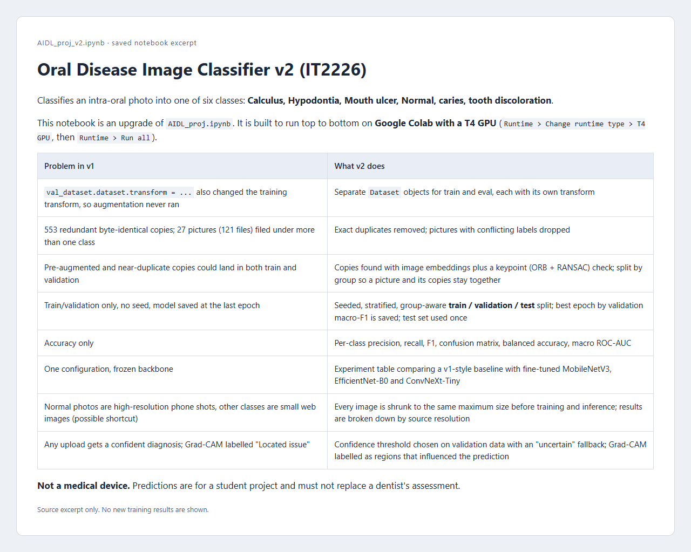

# Oral Disease Image Classifier

A Python training notebook for classifying oral photographs, prepared as Nanyang Polytechnic coursework. It focuses on data preparation, grouped train/validation/test splits, model comparison, evaluation and interpretable predictions.

**[Open the notebook in Google Colab](https://colab.research.google.com/github/TeddyQyuon/oral-disease-classifier/blob/main/AIDL_proj_v2.ipynb)**



## Scope and contribution

Coursework notebook and study notes maintained by Wai Yan Hpone Lat. The checked-in pipeline includes duplicate handling, group-aware splitting, training experiments, confidence-threshold evaluation, Grad-CAM focus circles (the area the model relied on, drawn on the photo) and model export.

This student project is not a medical diagnosis or a clinically validated tool. Model quality must be assessed from an actual training and held-out evaluation run; repository documentation is not clinical evidence.

## Stack

Python, PyTorch, torchvision, scikit-learn, OpenCV, pandas, matplotlib and Grad-CAM, running in Google Colab.

## Run the notebook

1. Open `AIDL_proj_v2.ipynb` using the Colab link above, or upload it to Colab.
2. Choose a T4 GPU runtime.
3. Add your own `KAGGLE_API_TOKEN` in Colab Secrets, or provide credentials through the notebook’s secure prompt. Never save credentials in notebook cells or outputs.
4. Run the notebook from top to bottom. The setup cell installs the extra Grad-CAM dependency; the dataset is downloaded from the [Oral Image Dataset on Kaggle](https://www.kaggle.com/datasets/jhirshaikh/oral-image-dataset).
5. Inspect the split checks, validation-selected model and held-out metrics before using predictions.
6. Save the generated model, model card, figures and experiment records before the Colab session ends.

To clone the source:

```bash
git clone https://github.com/TeddyQyuon/oral-disease-classifier.git
```

## Files

| File | Purpose |
|---|---|
| [AIDL_proj_v2.ipynb](AIDL_proj_v2.ipynb) | Data preparation, experiments, evaluation and export |
| [IT2226_Study_Guide.md](IT2226_Study_Guide.md) | Coursework study notes |

There is no application build or repository test command. Full model training requires the dataset and an appropriate Colab runtime. The preview above renders an excerpt of the saved notebook; it does not show a new training result.
